<div align="center">


<a href="https://github.com/vkn889">

</a>

<br/>

<a href="https://www.linkedin.com/in/viraat-nellutla-55b550322">

</a>
<a href="https://www.instagram.com/viraatnellutla88">

</a>
<a href="https://x.com/vkn889">

</a>
<a href="https://www.youtube.com/@cheesewx">

</a>

<br/><br/>


</div>

---

## 👋 About Me

I'm **Viraat**, a developer and researcher interested in building technology that improves people's lives.

I enjoy creating software, exploring artificial intelligence, and applying computational methods to biological and scientific problems. My goal is to turn ideas into useful products and research into meaningful impact.

- 🔭 Building **Molt** and other software projects
- 🧬 Exploring **computational biology and biomedical AI**
- 🧠 Interested in **machine learning, cybersecurity, and computational science**
- 🌍 Focused on **human-centered technology and positive impact**

<div align="center">


</div>

---

## 🛠️ Tech Stack

<div align="center">

**Languages**

<br/>


<br/><br/>

**Frameworks & Tools**

<br/>


<br/><br/>

**AI & Data Science**

<br/>


</div>

---

## 🚀 Featured Project: Molt

<div align="center">


<br/>

<a href="https://github.com/vkn889/Molt">

</a>

</div>

**Molt** is a native macOS app that brings a pixel companion, productivity widgets, and useful tools to your MacBook's notch.

It combines thoughtful design with practical features to make everyday computing more enjoyable.

- 🐣 Interactive pixel companion
- 🎵 Music and productivity controls
- 💻 Developer integrations
- 🍎 Native Swift experience

<div align="center">

<a href="https://github.com/vkn889/Molt">

</a>

</div>

---

## 📌 Featured Repositories

<div align="center">

<a href="https://github.com/vkn889/primer">

</a>

<a href="https://github.com/vkn889/metier">

</a>

<a href="https://github.com/vkn889/twig">

</a>

<a href="https://github.com/vkn889/partyHunt">

</a>

<br/>

<a href="https://github.com/vkn889?tab=repositories">

</a>

</div>

---

## 🧬 Computational Biology & Research

I'm interested in using computation and AI to better understand biological systems and human health.

My research focuses on machine learning, biomedical data analysis, and computational approaches to scientific problems.

**Machine Learning for Diabetes Prediction**

- Developed and evaluated supervised learning models for diabetes classification
- Worked with biomedical features including HbA1c, blood glucose, and BMI
- Compared model performance using precision, recall, and F1-score

I hope to contribute to research that makes healthcare more effective and accessible.

---

## 📊 GitHub Statistics

<div align="center">





<br/><br/>


</div>

---

## 🐍 Contribution Snake

<div align="center">


</div>

---

## 🌱 What I'm Exploring

```text id="axu49c"
Software Development   ████████████████████
AI & Machine Learning  ███████████████████░
Computational Biology  ██████████████████░░
Cybersecurity          ████████████████░░░░
Computational Science  ███████████████░░░░░
```

<div align="center">


</div>

---

## 🤝 Let's Connect

<div align="center">

I'm always interested in collaborating on meaningful projects.

[LinkedIn](https://www.linkedin.com/in/viraat-nellutla-55b550322) · [GitHub](https://github.com/vkn889) · [Instagram](https://www.instagram.com/viraatnellutla88)

<br/>


<br/>


</div>
